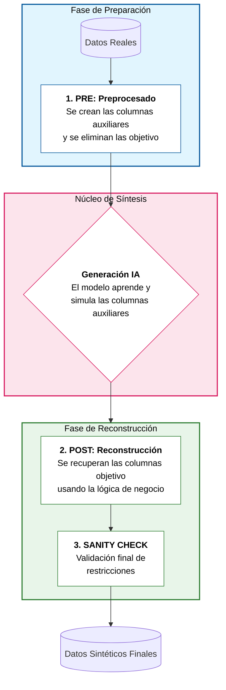
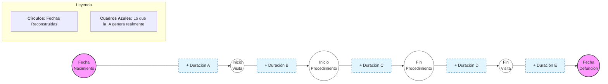
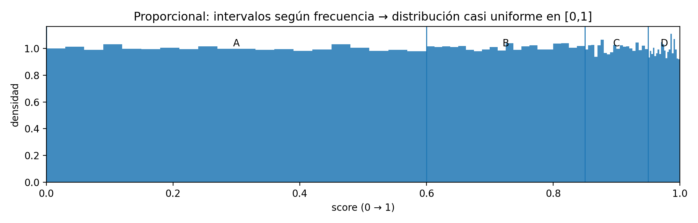
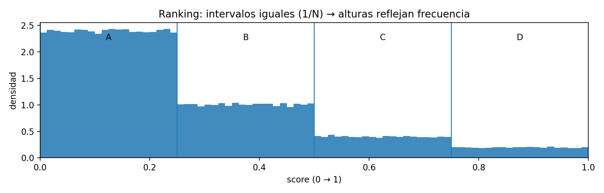
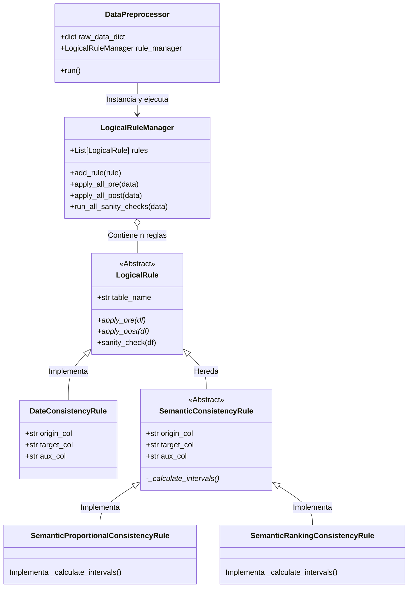

# Reglas Lógicas

La generación de datos sintéticos de alta calidad requiere no solo que la información "parezca" real estadísticamente, sino que respete estrictamente las reglas de negocio y la lógica del mundo real que los modelos a menudo ignoran. Un modelo podría aprender que un paciente suele recibir medicación, pero no comprende que es biológicamente imposible que un hombre sea diagnosticado con una patología ginecológica o que una fecha de alta sea anterior a una de ingreso. Este documento detalla el sistema de Reglas Lógicas, un mecanismo de control diseñado para garantizar que los datos generados sean coherentes, seguros y operativos, eliminando el riesgo de alucinaciones del modelo en relaciones críticas y asegurando que el activo de datos resultante sea plenamente confiable para la toma de decisiones o el entrenamiento de sistemas secundarios.

La idea clave es: **transformar los datos** a una representación más fácil para el modelo (PRE), **reconstruir** después (POST) y **validar** al final (SANITY CHECK).

> ⚠️ Nota: el sistema está diseñado para ser **extensible**. Las reglas descritas aquí son las actuales, pero se podrán añadir nuevas reglas siguiendo el mismo patrón sin cambiar la arquitectura.

## 1. Objetivo de las reglas

Los modelos generativos (tabulares o secuenciales) suelen fallar en:

- **Dependencias lógicas**
  - Ej.: `fecha_fin` debe ser posterior a `fecha_inicio`
- **Restricciones semánticas**
  - Ej.: “paciente pediátrico con una patología exclusivamente adulta”
  - Categorías que jamás aparecen en un cierto grupo

Las reglas lógicas atacan este problema **por diseño**, restringiendo explícitamente el espacio de opciones disponibles que puede simular el modelo para evitar generar estados inválidos.

#### Tabla ejemplo con inconsistencias
| ID_Paciente | Fecha_Nacimiento | Grupo_Edad | Fecha_Ingreso | Fecha_Alta | Diagnóstico | Medicación | Estado / Regla a aplicar |
| :--- | :--- | :--- | :--- | :--- | :--- | :--- | :--- |
| **P-001** | 1985-05-20 | **Adulto** | 2023-10-01 | 2023-10-05 | Hipertensión | Enalapril | ✅ **Correcto**<br>Datos coherentes. |
| **P-002** | 2018-03-15 | **Pediátrico** | 2023-11-10 | 2023-11-12 | Varicela | Paracetamol | ✅ **Correcto**<br>Lógica pediátrica respetada. |
| **P-003** | 1970-11-30 | Adulto | 2023-09-15 | **2023-09-10** | Diabetes Tipo 2 | Metformina | ❌ **Error Temporal**<br>La *Fecha_Alta* es anterior al ingreso.<br>🔧 *Aplica: DateConsistencyRule* |
| **P-004** | 2020-07-22 | **Pediátrico** | 2024-01-05 | 2024-01-05 | **Cáncer de Próstata** | Quimioterapia | ❌ **Error Semántico**<br>Diagnóstico imposible para el grupo de edad.<br>🔧 *Aplica: SemanticConsistencyRule* |
| **P-005** | 1995-02-14 | Adulto | 2023-12-20 | 2023-12-25 | Gripe | **Antibiótico** | ⚠️ **Sesgo Clínico**<br>Semánticamente posible, pero clínicamente incorrecto (virus vs bacteria).<br>🔧 *Depende de reglas avanzadas* |

---

## 2. Conceptos Clave

### 2.1 Clasificación de Columnas

| Tipo de Columna | Descripción | Dataset Original | Entrenamiento | Dataset Sintético Final |
| :--- | :--- | :---: | :---: | :---: |
| **Origen (Base)** | Datos de referencia de los que depende la regla. | ✅ Presente | ✅ Presente | ✅ Presente |
| **Auxiliar** | Creadas en **PRE** para simplificar la lógica (ej. duraciones). | ❌ No existe | ✅ **Creada** | ❌ **Eliminada** |
| **Objetivo (Target)** | La columna que queremos generar con control total. | ✅ Presente | ❌ **Eliminada** | ✅ **Reconstruida** |

## 3. Arquitectura general de las reglas

Cada regla implementa la interfaz `LogicalRule` y opera en **tres fases bien definidas**.

### 3.1 PRE — Preprocesado (antes de entrenar)

Transforma los datos para:

- Simplificar lo que el modelo tiene que aprender.
- Sustituir columnas “difíciles” (fechas, categorías dependientes) por columnas auxiliares **numéricas** o **más estables**.
- Eliminar columnas que podrían inducir incoherencias si el modelo las genera de forma independiente.

### 3.2 POST — Reconstrucción (después de simular)

Reconstruye el esquema original:

- Utilizando las columnas auxiliares simuladas.
- Regenerando las columnas objetivo eliminadas en PRE.
- Eliminando finalmente las columnas auxiliares.

Ejemplo (conceptual):
- `fecha_fin_simulada = fecha_inicio_simulada + duracion_simulada`

### 3.3 SANITY CHECK — Validación final

Comprueba que el resultado final cumple las restricciones de negocio.


---

## 4. Código e implementación
El sistema se basa en dos clases principales que separan la **lógica individual** de cada regla de la **gestión del pipeline**.

### 4.1 `LogicalRule`
Es una **clase base abstracta**. Cada implementación de una LogicalRule define los detalles de como realizar cada fase para esa regla lógica (fechas, semántica, rangos, etc.).

* **`apply_pre()`**: Transforma datos reales en algo digerible para la IA. Suele calcular columnas **Auxiliares** y eliminar las **Objetivo**.
* **`apply_post()`**: El proceso inverso. Toma lo que generó la IA y reconstruye las columnas **Objetivo**, eliminando el rastro de las auxiliares.
* **`sanity_check()`**: Validador interno para asegurar que, tras la reconstrucción, la regla se cumple al 100%.


### 4.2 `LogicalRuleManager`
Es el motor que gestiona y ejecuta todas las reglas de forma centralizada sobre un diccionario de tablas (los datos).

* **`apply_all_pre()`**: Ejecuta el pre-procesado de todas las reglas registradas.
* **`apply_all_post()`**: Ejecuta la reconstrucción. **Clave:** Lo hace en **orden inverso** (`reversed`) para asegurar que si una regla depende del resultado de otra, la cadena de reconstrucción sea coherente.
* **`run_all_sanity_checks()`**: Ejecuta los validadores de cada regla y consolida un reporte final de errores (un `DataFrame` único con todos los fallos detectados).

> Nota técnica: en `LogicalRuleManager`, las reglas se deben aplicar en **orden inverso** durante POST.
> Esto es importante porque una misma columna puede ser **target de una regla** y **origen de otra**, y durante el PRE, las target se eliminan.
> Aplicar POST en orden inverso asegura que las dependencias se reconstruyen correctamente.

## 5. Reglas implementadas actualmente

### 5.1 Consistencia de Fechas — `DateConsistencyRule`

> Limitación actual: opera **dentro de una sola tabla**.
> No enlaza fechas entre tablas (ej. `FechaVisita` vs `FechaNacimiento`).

#### 5.1.1 Problema
Cuando hay dos fechas relacionadas (ej. `fecha_inicio` y `fecha_fin`), el modelo puede no captar la relación lógica entre ambas. Es decir, puede aprender a generar cada fecha de forma independiente, lo que puede llevar a inconsistencias temporales.

El modelo puede generar:
- `fecha_fin < fecha_inicio`

#### 5.1.2 Solución

PRE:
1. Convertir fechas a `datetime`
2. Calcular duración:
   - `duracion = (fecha_fin - fecha_inicio).days`
3. Eliminar `fecha_fin`

POST:
1. Reconstruir `fecha_fin`:
   - `fecha_fin = fecha_inicio + timedelta(duracion)`
2. Eliminar `duracion`

SANITY CHECK:
- Error si `fecha_inicio > fecha_fin`

##### Garantía
- `fecha_fin` **siempre** depende de `fecha_inicio + duracion`, evitando incoherencias estructurales.

##### Clasificación de columnas

| Tipo de columna | Nombre |
|-----------------|--------|
| Origen          | `origin_col` (ej. `fecha_inicio`) |
| Auxiliar        | `aux_col` (ej. `duracion`) |
| Objetivo        | `target_col` (ej. `fecha_fin`) |



### 5.2 Consistencia Semántica — `SemanticConsistencyRule` (base abstracta)
SemanticConsistencyRule es la base abstracta para reglas que imponen restricciones semánticas en columnas categóricas dependientes basadas en columnas de origen. Primero explicamos la implementación de esta clase, luego detallamos dos estrategias concretas que heredan de ella y definen diferentes formas de construir los intervalos para representar la frecuencia de las categorías.

#### 5.2.1 Problema
Ciertas categorías solo deben existir si se cumple una condición en otra columna (ej: enfermedad de próstata no puede ocurrir en una niña de 5 años). La idea de esta regla es evitar por diseño que el modelo pueda simular combinaciones imposibles.

#### 5.2.2 Solución
##### 5.2.2.1 Enfoque general
La idea general es transformar la columna categórica dependiente (ej. `disease`) en una columna numérica (`disease_score`) que el modelo pueda aprender sin ver las categorías originales, y luego reconstruir la categoría original en POST usando la lógica de negocio.

1. **Agrupamos**: Primero agrupamos por el grupo de interés, generando una variable categórica para esa agrupación en caso de que no exista (ej. variable isPediatric a partir de la edad, para grupos de pacientes adultos/pediátricos).
2. **Creamos las lista de elementos que aparecen en cada grupo**. Esto lo hacemos extrayendo el listado de valores únicos de la variable de interés que puedan tener los registros asociados a cada grupo (ej. las enfermedades que hay en el dataset asociadas a niños, las que hay asociadas a adultos etc.).
3. **Transformamos los elementos categóricos a un intervalo** (PRE): Transformamos el nombre (ej. "Ibuprofeno Infantil") en un intervalo dentro de `[0,1]` para cada categoría válida *dentro de cada grupo*.
    - Ejemplo: tenemos 3 enfermedades asociadas a niños. En este caso ejemplo: varicela, diabetes y sarampión. Representaremos cada enfermedad con un intervalo o cajón (siempre entre 0 y 1) a cada una:

        - Varicela: [0.0 - 0.4]
        - Diabetes: [0.4 - 0.7]
        - Sarampión: [0.7 - 1.0]
4. **Muestreamos un valor aleatorio dentro del intervalo** (PRE):
    - La variable (la llamaremos disease_score) que le pasaremos al modelo para cada categoría será un número aleatorio dentro de su rango
        - Si el niño tiene varicela, `disease_score` podría valer por ejemplo 0.28 (valor aleatorio contenido entre 0 y 0.4).
    - Guardaremos estos intervalos en el LogicalRuleManager para luego en la fase de POST usarlos para reconstruir la columna objetivo.
5. **Entrenamos**: el modelo no ve la categoría de interés ni los intervalos, solamente ve un número que representa a la categoría de la columna objetivo, y aprende a generar este "score".
6. **Reconstruimos** (POST): Tras la simulación, miramos a qué grupo pertenece el paciente, y usamos el `disease_score` simulado para extraer la categoría resultante de la lista de elementos asociada a ese grupo
    - _Ejemplo_ ha simulado un `disease_score=0.1`:
        - Si estamos en un paciente que resulta ser niño, mirando en los intervalos guardados con las enfermedades para niños, esto corresponde a la varicela.
        - Pero si estamos en un paciente que es adulto, ese mismo `disease_score` corresponderá a otra enfermedad (ej. obesidad).

> Consecuencia clave: **si una categoría no existe en un grupo**, no tiene intervalo y **no puede aparecer** en datos sintéticos para ese grupo.

##### 5.2.2.2 Enfoque detallado: diferentes estrategias para definir los **intervalos**
Cómo decidimos la distribución de los intervalos? De momento hemos pensado en 2 estrategias. La diferencia entre estrategias está únicamente en el método `_calculate_intervals()`.

###### A) Estrategia Proporcional — `SemanticProportionalConsistencyRule` {#semantic-proportional}

**Objetivo**

- Forzar que las proporciones en sintético sean muy parecidas a las reales (por grupo).
- El modelo tiene menos libertad: respeta la “realidad estadística” del dataset original.

**Cómo se construyen los intervalos**

Dentro de cada grupo (por ejemplo “pediátrico”), repartimos el rango **[0,1]** entre las categorías según **lo frecuentes que son** en los datos reales:

1. **Medimos la frecuencia** de cada categoría dentro del grupo (qué porcentaje de filas pertenece a cada una).
2. **Asignamos más “espacio” a lo más común**:
   - Las categorías muy frecuentes reciben un intervalo más grande.
   - Las categorías raras reciben un intervalo más pequeño.
3. **Colocamos los intervalos seguidos**, sin huecos, hasta cubrir todo el rango:
   - La suma de todos los intervalos siempre termina en **1.0**.

**Intuición**: como el “trozo” de [0,1] de cada categoría ya incorpora su frecuencia real, al muestrear un `score` dentro de ese trozo, las proporciones se mantienen de forma muy estable.


**Qué ve el modelo**

- Al modelo le pasamos un `disease_score` = un valor aleatorio dentro del intervalo de la categoría. (Para 'insulina' que tiene un intervalo de 0.55 a 0.67, podría generarse el `disease_score=0.61`)
- Como el tamaño del intervalo se ajusta a laa frecuencia de la categoría, la distribución se queda plana.



**Qué garantiza SemanticProportionalConsistencyRule**

- **Garantía semántica** :
  - Para cada `group`, solo existen intervalos para categorías observadas en ese grupo.
  - Si una categoría no existía, no está en la lista de posibilidades para ese grupo y no puede aparecer en POST.
- **Garantía proporcional**:
    - La probabilidad de que cualquier valor aleatorio caiga en una categoría es exactamente igual a su frecuencia relativa real.
    - Esto hace que las proporciones se mantengan casi perfectas incluso si el modelo de IA tiene un rendimiento pobre o no logra captar bien la distribución.

**Qué NO garantiza SemanticProportionalConsistencyRule**

- Flexibilidad frente a sesgos:
    - No permite que el modelo corrija o ajuste las frecuencias si los datos originales estaban sesgados o tenían poco muestreo. Impone la realidad estadística del dataset original de forma rígida.
- Correlaciones complejas:
    - Al forzar que el tamaño del intervalo dicte la probabilidad, se le resta capacidad al modelo para decidir que, en ciertas condiciones específicas de otras variables, una categoría "rara" debería ser más frecuente.
- Aprendizaje activo de la distribución:
    - El modelo no necesita "esforzarse" en aprender la frecuencia de la categoría, ya que la regla asegura que las proporciones se mantenga, sin importar cómo se comporta el modelo.

###### B) Estrategia Ranking — `SemanticRankingConsistencyRule`

**Objetivo**

- Mantener la **validez semántica** (no combinaciones imposibles),
- pero permitir al modelo **alterar las proporciones** si lo considera coherente con el resto de variables generadas.

Esto se utiliza cuando:
- sospechamos que las proporciones reales tienen sesgos/muestreo limitado,
- o queremos que dar flexibilidad al modelo para que aprenda correlaciones más ricas sin imponer exactamente la distribución marginal del dataset original.

**Cómo se construyen intervalos**

Dentro de cada grupo, también repartimos el rango **[0,1]**, pero aquí **todas las categorías válidas reciben exactamente el mismo espacio**:

1. **Listamos las categorías válidas** del grupo (las que existen en los datos reales para ese grupo).
2. **Ordenamos esa lista por frecuencia**: las más comunes primero.
3. **Partimos [0,1] en partes iguales**:
   - Si hay `N` categorías, cada una ocupa `1/N`.
4. **Asignamos los intervalos en ese orden**:
   - Las categorías más frecuentes quedan “a la izquierda” (scores más bajos),
   - las menos frecuentes más “a la derecha”.
5. El último intervalo se ajusta para terminar exactamente en **1.0**.

**Intuición**: aquí los intervalos **no fuerzan** proporciones. Solo definen “qué categorías están permitidas” para el grupo. La frecuencia final la puede ajustar el modelo, pero sin salirse del conjunto válido.


**Qué ve el modelo**

- Al modelo le pasamos un `disease_score` = un valor aleatorio dentro del intervalo de la categoría, igual que en el método Proporcional, lo único que cambia entre métodos es como se construye el intervalo.
En Ranking, el tamaño del “cajón” NO refleja frecuencia real.
Aún así, al estar ordenados por frecuencia, los priemros cajones siempre correspondrán a las categorías más frecuentes, así que esperaríamos que el modelo aprendieria a simular más frecuentemente `scores` pequeños.

Eso implica:
- La distribución de `score` **no será uniforme** necesariamente.
- Si una categoría era muy frecuente en el dataset real, habrá muchas filas muestreando dentro de su cajón (aunque el cajón sea pequeño o grande, da igual: hay muchas filas ahí).
- Por tanto, el modelo ve que ciertos rangos de score aparecen más (los de categorías comunes) y aprende esas preferencias **si le encajan con el resto de señales**.



En otras palabras:
- **Proporcional**: el tamaño del intervalo fuerza la probabilidad.
- **Ranking**: el tamaño del intervalo es igual, y la “frecuencia” la aprende el modelo a partir de cuántas muestras caen en cada tramo en los datos de entrenamiento.

**Qué garantiza SemanticRankingConsistencyRule**

- **Garantía semántica** (idéntica a Proporcional):
  - Para cada `group`, solo existen intervalos para categorías observadas en ese grupo.
  - Si una categoría no existía, no está en la lista de posibilidades para ese grupo y no puede aparecer en POST.

**Qué NO garantiza SemanticRankingConsistencyRule**

- No fuerza que las proporciones sintéticas sean iguales a las reales.
- Si el modelo colapsa o exagera ciertos scores, se podrían ver:
  - distribución más concentrada en 1–2 categorías
  - o desplazamientos de frecuencia respecto al real.

# 6. Arquitectura e Implementación Técnica

## 6.1 Diagrama de Componentes

El sistema se estructura en torno a un orquestador principal (`DataPreprocessor`) y un gestor de estado (`LogicalRuleManager`).



## 6.2 Módulos y Responsabilidades

### A. Orquestación (preprocessor.py)

La clase DataPreprocessor actúa como el punto de entrada para la fase de entrenamiento (mode="train"). Su responsabilidad es garantizar que los datos pasen por todas las etapas de transformación antes de llegar al motor de síntesis.

- Limpieza (DataCleaner): Estandarización básica de tipos.
- Ingeniería de Reglas (LogicalRuleManager): Aquí se invoca apply_all_pre().
  Esto ocurre antes del profiling y la extracción de metadatos, para que el modelo "vea" las columnas auxiliares (scores, duraciones) en lugar de las columnas complejas originales.
- Metadatos (MetadataExtractor): Genera el esquema JSON que el modelo utilizará para entender tipos de datos (categóricos vs continuos, y relaciones entre columnas).

### B. El Contrato de Reglas (logical_rules.py)

Para garantizar la extensibilidad, todas las reglas deben heredar de la clase abstracta LogicalRule (ABC).

El "contrato" obliga a implementar dos métodos:

- apply_pre(df: pd.DataFrame) -> pd.DataFrame
  - Input: DataFrame original (raw).
  - Responsabilidad: Debe ser idempotente y devolver un DataFrame modificado.
    Debe gestionar la creación de columnas auxiliares y la eliminación (drop) de las columnas target para evitar que el modelo las aprenda directamente ("data leakage").

- apply_post(df: pd.DataFrame) -> pd.DataFrame
  - Input: DataFrame sintético (con columnas auxiliares predichas por la IA).
  - Responsabilidad: Reconstruir la columna target original usando lógica determinista.
    Debe limpiar las columnas auxiliares antes de devolver el resultado final.

### C. Gestión de Estado (LogicalRuleManager)

- Durante el PRE, almacena información (como los mapeos de intervalos en SemanticConsistencyRule) que no se pasa al modelo, pero que es necesaria para la reconstrucción.
- Este objeto se serializa (pickle) y se guarda junto al modelo entrenado.
- Después de la simulación, se deserializa el objeto para recuperar los mapeos exactos que se usaron durante el entrenamiento, garantizando la consistencia.

## 6.3 Configuración (rules.yaml)

El archivo rules.yaml mapea directamente los argumentos del constructor de las dataclasses.

Ejemplo de mapeo:

```yaml
- type: "date_consistency"
  table_name: "procedure_occurrence"
  origin_col: "procedure_datetime"
  ...
```

Se traduce dinámicamente en tiempo de ejecución a:

```python
DateConsistencyRule(
    table_name="procedure_occurrence",
    origin_col="procedure_datetime",
    ...
)
```

# 7. Comparación con Implementaciones Existentes

Synthetic Data Vault (SDV), así como programas específicamente orientados al sector salud como HealthGAN, utilizan una técnica casi idéntica para la transformación de variables categóricas durante el proceso de generación de datos como nuestra [SemanticProportionalConsistencyRule](#semantic-proportional) [1, 2]. Además, SDV permite la especificación de lógica de negocio. En la versión gratuita solo se ofrecen cinco tipos distintos de restricciones, mientras que en SDV Enterprise existe el complemento de pago Constraint-Augmented Generation (CAG), que proporciona una amplia variedad de restricciones predefinidas [3]. Estas restricciones utilizan el mismo proceso de transformación que nuestra implementación, en el sentido de que las columnas se eliminan temporalmente y se reemplazan por representaciones más fáciles de aprender para el modelo, tal como se deriva del análisis del código en [4]. Tras realizar esta transformación, el modelo aprende a generar resultados en la categoría auxiliar, que luego se convierten de nuevo a su forma original antes de la salida de los datos sintéticos. Un ejemplo de una regla simple sería start date < end date, en la cual la columna end date se elimina temporalmente y se reemplaza por una columna de duración. En SDV, esto se implementa como la restricción "Inequality" [5].

Un factor importante a considerar es el manejo de las reglas superpuestas. Estas son reglas en las que una misma columna participa simultáneamente en múltiples restricciones y, por lo tanto, tendría que ser eliminada y reemplazada más de una vez durante el preprocesamiento. En SDV, las restricciones se aplican generalmente de manera independiente y secuencial, lo que puede generar ambigüedades cuando varias restricciones apuntan a la misma columna. Como resultado, SDV opta por implementar "rejection sampling" durante el posprocesamiento en estos escenarios, lo que puede ralentizar considerablemente la generación de registros. Debido a la complejidad de estos casos, soluciones de investigación como HealthGAN no suelen implementar reglas así. Otra plataforma popular para la generación de datos tabulares sintéticos, Synthcity, permite la definición de restricciones que se aplican mediante rejection sampling, aunque estas solo pueden referirse a valores numéricos fijos, por ejemplo edad < 100, y no a otras columnas [6].

Las reglas superpuestas son distintas de las reglas concatenadas. En una regla concatenada, una columna cumple dos funciones, ya que las reglas se encadenan entre sí. Un ejemplo es la regla ChainedInequality en SDV, que gestiona situaciones como start date < procedure date < end date. En este caso, la columna "procedure date" debe actuar tanto como salida de la regla start date < procedure date como entrada de la regla procedure date < end date. Esta regla solo está disponible para clientes de SDV Enterprise y, por lo tanto, no es posible analizar su código fuente. No obstante, se puede asumir que sigue la misma estructura que la solución simple de dos fechas: ambas columnas se convierten en duraciones y, durante el posprocesamiento, se hace referencia a la posición original de cada una para construir la tabla final.

Aunque todavía no hemos comenzado la implementación de reglas superpuestas, nuestro método para implementar reglas simples y concatenadas será muy similar. Como se explicó anteriormente, las columnas se eliminarán temporalmente y se reemplazarán por representaciones más simples. Para las reglas concatenadas, requeriremos un orden descendente, es decir, end date > procedure date > start date. Esto difiere del enfoque de SDV, que utiliza, al menos en los parámetros de los funciones, un orden ascendente, ya que nuestra implementación actual se basa en un orden inverso durante el posprocesamiento. Si, durante esta fase, comenzáramos con una regla que no incluyera la start date, no tendríamos forma de reconstruir correctamente las dependencias temporales necesarias para generar los valores finales coherentes.

### 7.1 Otras Herramientas

En YData, las reglas lógicas se definen como "reglas calculadas" [7]. Estas utilizan un enfoque manual en el que el usuario define una función para cada regla. Dicha función recibe una o más columnas como entrada y, a partir de ellas, crea una nueva columna durante el posprocesamiento. Para utilizar este formato en un caso como start date < end date, sería necesario insertar manualmente una columna de duración y omitir la columna end date, para luego definir una función que reconstruya la fecha de fin a partir de la duración. Tras el procesamiento, la columna de duración debe eliminarse.

Gretel.ai ofrece un soporte básico para reglas lógicas. Permite definir restricciones de desigualdad entre una columna y un valor escalar, o entre dos columnas [8]. La versión de código abierto gretel-synthetics utiliza parte de la implementación de restricciones desarrollada originalmente en SDV.


### Bibliografía

[1] N. Patki, R. Wedge, and K. Veeramachaneni, “The Synthetic Data Vault,” in 2016 IEEE International Conference on Data Science and Advanced Analytics (DSAA), Oct. 2016, pp. 399–410. doi: 10.1109/DSAA.2016.49.

[2] A. Yale, S. Dash, R. Dutta, I. Guyon, A. Pavao, and K. P. Bennett, “Generation and evaluation of privacy preserving synthetic health data,” Neurocomputing, vol. 416, pp. 244–255, Nov. 2020, doi: 10.1016/j.neucom.2019.12.136.

[3] “Predefined Constraints,” Synthetic Data Vault Documentation. Accessed: Feb. 02, 2026. [Online]. Available: https://docs.sdv.dev/sdv/concepts/constraint-augmented-generation-cag/predefined-constraints

[4] “SDV/sdv/cag,” GitHub. Accessed: Feb. 02, 2026. [Online]. Available: https://github.com/sdv-dev/SDV/tree/main/sdv/cag

[5] “Predefined Constraints: Inequality,” Synthetic Data Vault Documentation. Accessed: Feb. 02, 2026. [Online]. Available: https://docs.sdv.dev/sdv/concepts/constraint-augmented-generation-cag/predefined-constraints/inequality

[6] “Constraints Plugin,” Synthcity Documentation. Accessed: Feb. 03, 2026. [Online]. Available: https://synthcity.readthedocs.io/en/latest/generated/synthcity.plugins.core.constraints.html

[7] “Synthetic Data with Calculated Features,” YData SDK Documentation. Accessed: Feb. 03, 2026. [Online]. Available: https://docs.sdk.ydata.ai/latest/getting_started/synthetic_data/tabular/calculated_features/

[8] “Data Designer SDK,” Gretel Client Documentation. Accessed: Feb. 03, 2026. [Online]. Available: https://python.docs.gretel.ai/en/stable/data_designer.html#hand-constraints
