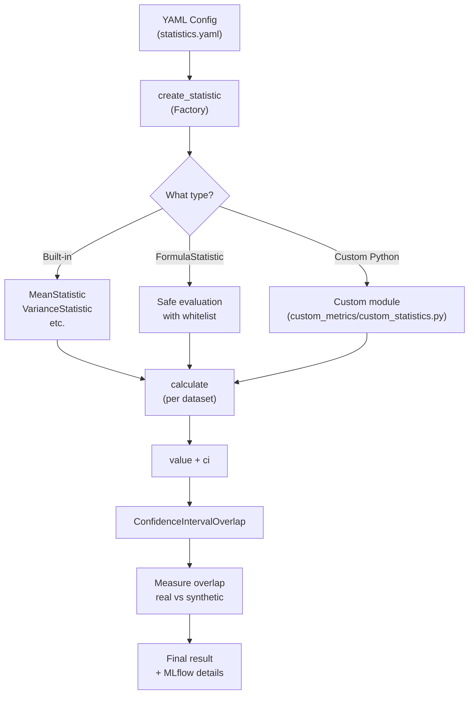

[<-- Back to Evaluation](evaluation.md)

# Confidence Interval Overlap (CIO) Metrics

## Introduction

The **Confidence Interval Overlap (CIO)** metric is a mathematical tool that compares the statistical distribution of real data with the generated synthetic data. **Its main objective is to measure whether the synthetic distribution replicates the original distribution**, regardless of whether the individual values are identical.

The concept is simple but powerful:
- A statistic (mean, median, variance, etc.) is calculated on **real data** → real confidence interval.
- The **same statistic** is calculated on **synthetic data** → synthetic confidence interval.
- The **overlap between both intervals** is measured (0 = no overlap, 1 = total overlap).
- A value **close to 1 indicates that the distributions are similar**.

### Key Difference: CIO vs other metrics

| Metric | Objective | What it detects |
| :--- | :--- | :--- |
| **CIO** | Utility | Do the data have the same statistical shape? |
| **Common Rows Proportion** | Privacy | Are exact rows reproduced? |
| **Nearest Neighbor Distance** | Privacy | How close are synthetic data to real data? |
| **TSTR** | Utility | Does a model trained with synthetic data work on real data? |

---

## 1. General Architecture

### 1.1 Main Components

The CIO metric is divided into two layers:

```text
┌─────────────────────────────────────────────────┐
│      METRIC: ConfidenceIntervalOverlap         │
│ (src/evaluation/custom_metrics/confidence_interval_overlap.py) │
│                                                 │
│  Responsibilities:                             │
│  • Load statistics configuration                │
│  • Calculate intervals on real data             │
│  • Calculate intervals on synthetic data          │
│  • Measure overlap of each interval             │
│  • Return aggregated score + details            │
└─────────────────────────────────────────────────┘
                      ↓
┌─────────────────────────────────────────────────┐
│   STATISTICS: Statistic & subclasses           │
│   (src/evaluation/statistics.py)                │
│                                                 │
│  Responsibilities:                             │
│  • Validate data and columns                    │
│  • Calculate the statistic (value)              │
│  • Generate confidence interval (bootstrap)     │
│  • Return {value, ci}                           │
└─────────────────────────────────────────────────┘
```

### 1.2 Execution Flow



---

## 2. Available Statistics (Built-in)

### 2.1 Complete list of built-in statistics

| Name | Description | Formula / Details | Usage |
| :--- | :--- | :--- | :--- |
| **mean** | Arithmetic mean | $\bar{x} = \frac{1}{n}\sum x_i$ | Central tendency |
| **median** | Median (50th percentile) | Ordered central value | Robust central tendency |
| **mode** | Mode (most frequent value) | Argmax(freq) | Modal tendency |
| **variance** | Variance | $s^2 = \frac{1}{n-1}\sum (x_i - \bar{x})^2$ | Dispersion |
| **skewness** | Fisher-Pearson skewness | Measures bias (left/right) | Distribution shape |
| **kurtosis** | Excess kurtosis | Measures tails (heavy/light) | Tail behavior |
| **quantile** | Generic percentiles | $Q_p$ : value at percentile p | Specific points (e.g., Q1, Q3) |

### 2.2 Configuration in `statistics.yaml`

Each statistic requires:
- `operation`: name of the statistic.
- `table`: name of the table to use.

Additionally:
- `col`: name of the column.
- **or** `columns`: dictionary with `col` and additional columns.
  - Example: `{"col": "dob", "col2": "admittime"}`.

Optional:
- `convert_to_categorical`: `False`.
  - Determines if columns should be converted to categorical type. Defaults to `True`.

**Example:**
```yaml
statistics:
  - operation: "mean"
    table: "dataset_v2"
    col: "age"
  
  - operation: "variance"
    table: "dataset_v2"
    col: "age"

  - operation: "quantile"
    table: "dataset_v2"
    col: "age"
    quantile: 0.25  # Q1

  - operation: "age"
    table: "dataset_v2"
    convert_to_categorical: False
    columns: {"col": "dob", "col2": "admittime"}
```

---

## 3. Confidence Intervals: Bootstrap

### 3.1 How are intervals calculated?

All statistics (built-in, formula-based, custom) use **bootstrap resampling** to estimate confidence intervals:

1. **Original data**: A series of $n$ values.
2. **Generate bootstrap samples**: Create $B = 10,000$ samples of size $n$ with replacement.
3. **Calculate statistic on each sample**: Obtain 10,000 estimates.
4. **Extract percentiles**:
   - $CI_{lower} = \text{percentile}(\alpha/2, \text{bootstrap values})$
   - $CI_{upper} = \text{percentile}(1 - \alpha/2, \text{bootstrap values})$

In our case: $\alpha = 1 - 0.95 = 0.05$ → 2.5 and 97.5 percentiles.

### 3.2 Advantages of Bootstrap

- **Does not assume normality** of the data (flexibility).
- **Works with any statistic** (mean, variance, custom formulas).
- **Reliable estimation** with sufficient sample size.

### 3.3 Configurable Parameters

| Parameter | Current Value | Location | Notes |
| :--- | :--- | :--- | :--- |
| Number of resamplings | 10,000 | `config/general_config.py`<br/>`NUM_BOOTSTRAP_SAMPLES` | ↑ = more precise but slower |
| Confidence level | 0.95 | `config/general_config.py`<br/>`CONFIDENCE_INTERVAL_LEVEL` | 0.95 = 95% CI |

---

## 4. Custom Statistics: Formula-Based (YAML)

### 4.1 Concept

Allows users to define **data transformations** directly in the YAML configuration without writing Python code, with security guaranteed by a **whitelist of allowed functions**.

### 4.2 Syntax

```yaml
- operation: "custom_formula"
  table: "table_name"
  col: "primary_column"      # For single-column formulas
  columns: {'col': 'primary_column', 'col2': 'other_col'}    # For multi-column formulas
  formula: "({col} - {col2}) / {col2}"  # {placeholder} is replaced before evaluation
```

### 4.3 Allowed Functions (Whitelist)

For **security**, only the following are allowed:

| Function | Module | Description |
| :--- | :--- | :--- |
| `np.*` | NumPy | `np.sqrt()`, `np.log()`, `np.exp()`, `np.abs()`, etc. |
| `pd.*` | Pandas | Series methods: `.mean()`, `.std()`, `.min()`, `.max()`, etc. |
| `min`, `max`, `sum` | Built-in | Native Python aggregators |
| `mean`, `std`, `var` | Wrappers | For Series: `mean(x)` = `x.mean()` |

**Explicitly forbidden:**
- `__import__`, `exec`, `eval` (injection).
- `getattr`, `setattr`, `globals`, `locals`, `open`.
- `os`, `sys`, `subprocess`.

### 4.4 Practical Examples

```yaml
# 1. Simple transformation (square root)
- operation: "custom_formula"
  table: "patients"
  col: "age"
  formula: "np.sqrt({col})"

# 2. Logarithmic transformation
- operation: "custom_formula"
  table: "patients"
  col: "age"
  formula: "np.log({col})"

# 3. Standardization (z-score)
- operation: "custom_formula"
  table: "patients"
  col: "age"
  formula: "({col} - {col}.mean()) / {col}.std()"

# 4. Proportions / Ratios
- operation: "custom_formula"
  table: "medical_data"
  columns: {'col': 'systolic_bp', 'col2': 'diastolic_bp'}
  formula: "{col} / {col2}"
```

### 4.5 Formula Evaluation Flow

1. Load YAML config.
2. Validate formula syntactically (`compile`).
3. Check for forbidden words.
4. Create mapping `{placeholder: actual_column}`.
5. Replace placeholders: `"{col}"` → `"col"`.
6. Evaluate formula in a safe context.
7. Apply bootstrap for CI.
8. Return `{value, ci}`.

---

## 5. Custom Statistics: Python Classes

### 5.1 Motivation

For complex statistics that require:
- **Advanced custom logic**.
- **Special exception handling**.
- **Non-standard CI calculation**.
- **Internal parameters and state**.

### 5.2 Basic structure of a custom statistic

```python
from src.evaluation.statistics import Statistic
from typing import Any
import pandas as pd
import numpy as np

class MyCustomStatistic(Statistic):
    """Statistic description."""
    
    def __init__(self, table: str, column: str, confidence_level: float, 
                 param_a: float = 5.0):
        """Additional parameters via YAML."""
        super().__init__(table, column, confidence_level)
        self.param_a = param_a

    @staticmethod
    def name() -> str:
        """Name used in YAML (operation: 'my_statistic')."""
        return "my_statistic"

    def calculate(self, data: pd.DataFrame) -> dict[str, Any]:
        """Main calculation: returns {value: float, ci: (lower, upper)}."""
        
        # 1. Preprocess
        series = self._preprocess_series(data)
        if series is None:
            return {'value': np.nan, 'ci': (np.nan, np.nan)}

        # 2. Calculate statistic
        value = float(series.mean()) ** self.param_a

        # 3. Generate CI with bootstrap
        ci = self._bootstrap_confidence_interval(
            series,
            value,
            lambda x: float(x.mean()) ** self.param_a
        )

        return {'value': value, 'ci': ci}
```

### 5.3 Location and Registration

**File**: `src/evaluation/custom_metrics/custom_statistics.py`

```python
# Export in the CUSTOM_STATISTIC_MAP dictionary
CUSTOM_STATISTIC_MAP = {
    "my_statistic": MyCustomStatistic,
    "other_statistic": OtherStatistic,
}
```

### 5.4 Enabling Custom Statistics

```bash
# Option 1: Environment variable
export CUSTOM_STATISTICS_MODULE="src.evaluation.custom_metrics.custom_statistics"

# Option 2: Directly in config/general_config.py
CUSTOM_STATISTICS_MODULE = "src.evaluation.custom_metrics.custom_statistics"
```

### 5.5 Usage in YAML

```yaml
- operation: "my_statistic"
  table: "dataset_v2"
  col: "age"
  param_a: 2.5  # Custom parameter (optional)
```

### 5.6 Included Custom Statistics (examples)

| Class | Name (operation) | Description |
| :--- | :--- | :--- |
| `CoefficientOfVariationStatistic` | `coefficient_of_variation` | CV = (std/mean) × 100 |
| `InterquartileRangeStatistic` | `interquartile_range` | IQR = Q3 - Q1 |
| `NullProportionStatistic` | `null_proportion` | Proportion of null values |

---

## 6. Return Values and MLflow

### 6.1 Return structure per statistic

Each statistic (built-in, formula, custom) returns:

```python
{
    'value': float,           # Calculated statistic value
    'ci': (float, float)      # Confidence interval (lower, upper)
}
```

**Real example:**
```python
{
    'value': 35.6,
    'ci': (34.2, 37.1)
}
```

### 6.2 CIO (metric) return structure

```python
{
    "score": 0.87,                    # Average overlap [0-1]
    "additional": {
        "table_age_MeanStatistic": {
            "overlap": 0.92,          # Overlap of this statistic
            "real_ci_lower": 30.5,
            "real_ci_upper": 40.2,
            "synthetic_ci_lower": 31.1,
            "synthetic_ci_upper": 41.8,
            "real_value": 35.8,
            "synthetic_value": 36.5
        },
        # ... more statistics ...
    },
    "direction": "maximize"           # Goal: higher is better
}
```

### 6.3 Low Quality Cases

When **there is no valid data**, the following is returned:

```python
{
    'value': nan,
    'ci': (nan, nan)
}
```

**Common reasons:**
- Column does not exist in the table.
- The entire column is null.
- Column is not numeric.
- Formula has an evaluation error.

[<-- Back to Evaluation](evaluation.md)
