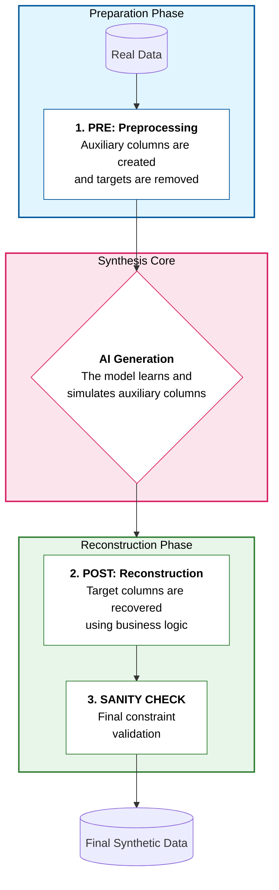
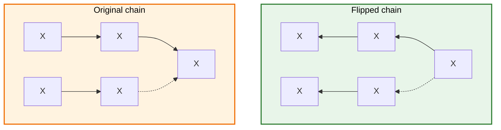
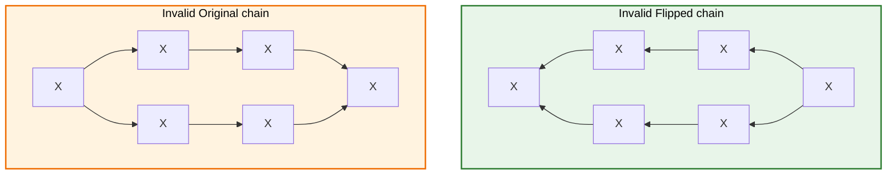
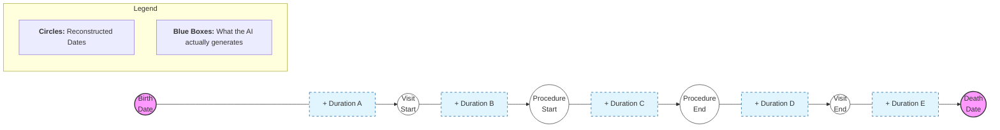
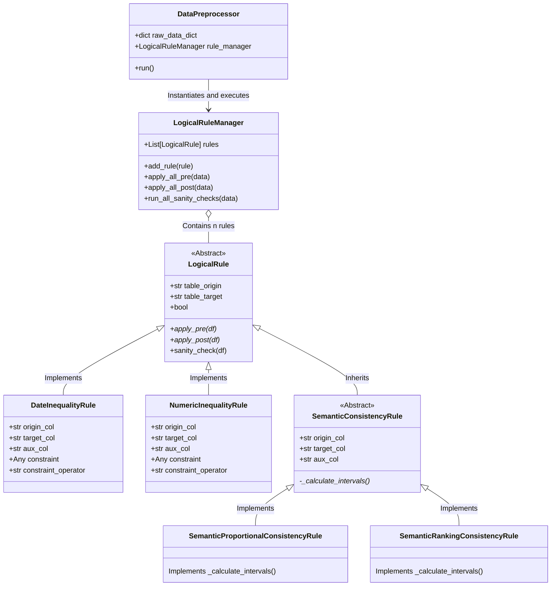

[<-- Back to Main Index](../../README.md)

# Logical Rules

High-quality synthetic data generation requires not only that the information "looks" real statistically but that it strictly respects business rules and real-world logic that models often ignore. A model might learn that a patient usually receives medication but doesn't understand that it is biologically impossible for a man to be diagnosed with a gynecological pathology or for a discharge date to be earlier than an admission date. This document details the Logical Rules system, a control mechanism designed to ensure that generated data is consistent, secure, and operational, eliminating the risk of model hallucinations in critical relationships and ensuring that the resulting data asset is fully reliable for decision-making or secondary system training.

The key idea is: **transform the data** into a representation easier for the model (PRE), **reconstruct** afterwards (POST), and **validate** at the end (SANITY CHECK).

> ⚠️ Rules are meant to ensure existing constraints in the data are maintained, not to force arbitrary ones. If the data does not have a certain constraint, it should not be added as a rule as it will create statistical distortion.

> ⚠️ Note: the system is designed to be **extensible**. The rules described here are the current ones, but new rules can be added following the same pattern without changing the architecture.

## 1. Objective of the Rules

Generative models (tabular or sequential) often fail in:

- **Logical dependencies**
  - E.g.: `end_date` must be after `start_date`.
- **Semantic constraints**
  - E.g.: "pediatric patient with an exclusively adult pathology".
  - Categories that never appear in a certain group.

Logical rules attack this problem **by design**, explicitly restricting the space of available options the model can simulate to avoid generating invalid states.

#### Example table with inconsistencies
| Patient_ID | Birth_Date | Age_Group | Admission_Date | Discharge_Date | Diagnosis | Medication | Status / Rule to apply |
| :--- | :--- | :--- | :--- | :--- | :--- | :--- | :--- |
| P-001 | 1985-05-20 | Adult | 2023-10-01 | 2023-10-05 | Hypertension | Enalapril | ✅ **Correct**<br>Consistent data. |
| P-002 | 2018-03-15 | Pediatric | 2023-11-10 | 2023-11-12 | Chickenpox | Paracetamol | ✅ **Correct**<br>Pediatric logic respected. |
| P-003 | 1970-11-30 | Adult | 2023-09-15 | **2023-09-10** | Type 2 Diabetes | Metformin | ❌ **Temporal Error**<br>Discharge_Date is earlier than admission.<br>🔧 *Applies: DateInequalityRule* |
| P-004 | 2020-07-22 | **Pediatric** | 2024-01-05 | 2024-01-05 | **Prostate Cancer** | Chemotherapy | ❌ **Semantic Error**<br>Impossible diagnosis for the age group.<br>🔧 *Applies: SemanticRankingConsistencyRule / SemanticProportionalConsistencyRule* |
| P-005 | 1995-02-14 | Adult | 2023-12-20 | 2023-12-25 | Flu | **Antibiotic** | ⚠️ **Clinical Bias**<br>Semantically possible, but clinically incorrect (virus vs bacteria).<br> |

---

## 2. Key Concepts

### 2.1 Column Classification

Before explaining how a rule is applied, we describe here how we classify types of columns:

| Column Type | Description | Original Dataset | Training | Final Synthetic Dataset |
| :--- | :--- | :---: | :---: | :---: |
| **Source (Base)** | Reference data on which the rule depends. | ✅ Present | ✅ Present | ✅ Present |
| **Auxiliary** | Created in **PRE** to simplify logic (e.g., durations). | ❌ Non-existent | ✅ **Created** | ❌ **Removed** |
| **Target** | The column we want to generate with full control. | ✅ Present | ❌ **Removed** | ✅ **Reconstructed** |

## 3. General Rule Architecture

Each rule implements the `LogicalRule` interface and operates in **three well-defined phases**.

### 3.1 PRE — Preprocessing (before training)

Transforms the data to:

- Simplify what the model has to learn.
- Replace "difficult" columns (dates, dependent categories) with **numerical** or **more stable** auxiliary columns.
- Remove columns that could induce inconsistencies if the model generates them independently.

### 3.2 POST — Reconstruction (after simulating)

Reconstructs the original schema:

- Using the simulated auxiliary columns.
- Regenerating the target columns removed in PRE.
- Finally removing the auxiliary columns.

Example:
- `simulated_end_date = simulated_start_date + simulated_duration`

### 3.3 SANITY CHECK — Final Validation

Checks that the final result meets the business constraints.

---
### Overview


---

### 3.4 Correlation Distortion and Risks

While logical rules provide a deterministic guarantee, they must be used with caution. A rule should ideally **reflect the underlying reality** of the training data. If you use a rule to "force" a reality that doesn't exist in the source dataset, you will introduce statistical distortion.

#### The Problem: "Violent Clipping"
If you set a rule `age >= 18` but your training data contains many children (e.g., ages 5-17):
1. **PRE**: The difference `age - 18` will be negative for all children.
2. **AI**: The model learns that negative differences are valid and generates them for records it perceives as "children" based on other features (e.g., `is_student=True`).
3. **POST**: Our reconstruction logic applies `.clip(lower=0)`. All those negative values become `0`.
4. **Result**: 
   - **Unnatural Spikes**: You will see a massive, non-existent spike of patients exactly at age 18.
   - **Broken Correlations**: You get "inconsistent" rows, such as an 18-year-old who has attributes only a child would have (pediatric diagnoses, specific medications). The rule fixes the `age` column but cannot "fix" the rest of the row's learned correlations.

#### Recommended Solutions

If your constraint needs to deviate significantly from the training data distribution, consider these alternatives:

> If you want to condition your model completely, creating a model that specifically generates data for a certain subpopulation that complies with this constraint:

1. **Filter the Training Data**: 
   If you only want synthetic adults, the best approach is to **delete all rows where `age < 18` from the source data** before training. The model will then naturally only learn and generate adult distributions.
   
2. **The Proxy Column Trick (for diversity)**:
   Instead of a hard rule, add a categorical column like `is_adult` (True/False) to your training data. During generation, use **Conditional Generation** (see [Conditional Generation](conditional_generation.md)) by seeding `is_adult = True`. This allows the model to naturally "filter" its own output while maintaining valid internal correlations.

> If you want to create a model that is generalistic, will generate any type of value by default, but that can be conditioned to generate specific values for certain columns:

3. **Rejection Sampling**:
   Rejection sampling allows the engine to generate a record, check it against a rule, and "discard and retry" if it fails. This is the only way to maintain perfect correlations without proxy columns, though it can be significantly slower during generation. See [Rejection Sampling](rejection_sampling.md) for more details.

---

## 4. Code and Implementation

The system is based on two main classes that separate the **individual logic** of each rule from the **pipeline management**.

### 4.1 `LogicalRule`
It is an **abstract base class**. Each implementation of a LogicalRule defines the details of how to perform each phase for that logical rule (dates, semantics, ranges, etc.).

* **`apply_pre()`**: Transforms real data into something digestible for the AI. Usually calculates **Auxiliary** columns and removes **Target** ones.
* **`apply_post()`**: The reverse process. Takes what the AI generated and reconstructs the **Target** columns, removing the trace of the auxiliaries.
* **`sanity_check()`**: Internal validator to ensure that, after reconstruction, the rule is 100% met.

Additionally, all rules share these structural fields:

- `table_origin`: context or reference table.
- `table_target`: table on which the target column is transformed/reconstructed.


### 4.2 `LogicalRuleManager`
It is the engine that manages and executes all rules centrally on a dictionary of tables.

* **`apply_all_pre()`**: Executes the pre-processing of all registered rules.
* **`apply_all_post()`**: Executes the reconstruction. **Key:** It does so in **reverse order** (`reversed`) to ensure that if one rule depends on the result of another, the reconstruction chain is consistent.
* **`run_all_sanity_checks()`**: Executes the validators of each rule and consolidates a report per rule.

It also automatically resolves rules that depend on another table:

- If `table_origin != table_target`, it creates a **temporary view with a join**.
- The join relies on `relationships` from the metadata.
- After PRE/POST, it removes the columns brought from the origin table and keeps those of the target.

> Technical note: in `LogicalRuleManager`, rules must be applied in **reverse order** during POST.
> This is important because the same column can be the **target of one rule** and the **origin of another**, and during PRE, targets are removed.
> Applying POST in reverse order ensures that dependencies are reconstructed correctly.

### 4.3 Rule Interaction Detection and Ordering

Since most rules will be removing a column during their PRE phase, they must be ordered properly. Logical rules can be **isolated**, **overlapping**, or **concatenated**. The manager enforces valid ordering right before applying PRE rules so that no rule references a column that has already been removed. The ordering and validation are driven by column-level dependencies and a directed graph built with the library NetworkX.

#### 4.3.1 Isolated Rules
Rules without any interaction with other rules on their referenced columns. No issues at the time of implementation. Ex: All rejection sampling rules are considered isolated, as by definition they cannot create or remove any columns.
#### 4.3.2 Overlapping/Superimposed Rules
Overlapping/superimposed rules refers to two or more rules that have the same target. In this case, both rules would try to delete the same column. We detect these interactions as each rule is added to the rule manager. We are able to resolve these in 2 different ways, depending on the type of rule.

For semantic consistency rules: Create a combined group key based on the joining of the source columns. For instance, if we have a semantic rule on Age -> Disease and we attempt to add another on Gender -> Disease, a superimposition will be detected. Instead of creating a new rule, we will add on to the first rule, which will become Age + Gender -> Disease. This way we are able to calculate the valid combinations using both variables.

For number/date inequality rules: We flip the rule. For instance DOB < Visit becomes Visit > DOB. Through this method, rules that share the same target can be changed into rules that share the same origin, which is not an issue as the origin is not deleted. Furthermore, we have implemented the logic to propogate this change through a limitless number of concatenated rules, flipping each pair.



However, there are 2 requirements for this process. All rules must be of the same type (no mixing numeric inequality rules with date inequality rules). And there must not exist columns that are already the source for multiple rules before the flip, which would just result in us creating another superimposition at the time of the flip, as shown below.



#### 4.3.3 Concatenated Rules
Concatenated rules occur when the source column of a rule (rule A) is the target column of other rule (Rule B). The rule that uses it as the source must be ordered before the rule that uses it as a column. We have chosen to abstract this problem to a directed graph, in which the nodes are the rules. If rule A creates a column that rule B needs, we connect them A -> B. If rule A deletes a column that rule B needs, we connect them B -> A. The direction of the edges represents the each required pairwise ordering. 

By using a graph, we are able to convert this from a convoluted, internally intertwined problem to one with widely studied and implemented solutions. We have chosen to take a solution from the established NetworkX python package, using a topological sort that ensures a valid ordering of the directed graph, as long as no cycles exist. Before performing the sort, we use NetworkX to detect cycles, which would result in us returning an error to the user.

Through providing these algoirthmns for the resolution and correction of user-defined rules, we greatly reduce the complexity for the user. The user does not have to worry about how rules are enacted internally, or any ordering constraints. They can simply define what relations between columns are required, and the program will resolve most issues.

#### 4.3.4 Code
##### 4.3.4.1 `add_rule()`

Registers a new rule in the manager after checking conflicts (with _detect_rule_interactions).

- **Superimposition (overlap):** if another rule already targets the same table + column,
  a `RuleSuperimpositionError` is raised.
- **Concatenation:** if the rule depends on columns produced or removed by another rule,
  both rules are tracked in `concat_rules` so they can be ordered later.

##### 4.3.4.2 `_detect_rule_interactions()`

Compares the new rule against all registered rules and classifies interactions.

- **Inputs:** a `LogicalRule` to check.
- **Outputs:** updates `concat_rules` when dependencies are found.
- **Logic:**
  - Computes each rule's **source columns** (what it needs), **produced columns** (what it
    creates), and **removed columns** (what it deletes in PRE).
  - If a rule needs a column that another rule produces or removes, they are concatenated.

##### 4.3.4.3 `_sort_concat_rules()` (NetworkX-based)

Called in apply_all_pre. Orders concatenated rules so every dependency is respected. Also logs a warning and skips for any rules
that refer to inexistent columns. This is accomplished through first formatting all rules into a directed graph. The library NetworkX 
is then used for cycle detection, ensuring that there are no incomputable cyclic relationships. Then, NetworkX is used to perform a 
topological sort, ordering all rules into the appropriate positions. There are various tests for this ordering present in tests/test_logical_rules.py.

**Steps:**

1. **Collect columns** from the input tables to validate that all referenced origin/source
   columns exist.
2. **Build a dependency graph** (`nx.DiGraph`) where each node is a rule index.
   - Edge `A -> B` means rule `B` depends on outputs or removals of rule `A`.
   - Dependencies come from:
     - **Produced columns** (`aux_col`)
     - **Removed columns** (targets dropped during PRE)
3. **Cycle detection**: `nx.find_cycle()` checks if the graph contains a cycle.
   - If a cycle exists, the ordering is impossible and `RuleConcatenationError` is raised.
4. **Topological sorting**: `nx.algorithms.dag.lexicographical_topological_sort()` returns a
   stable, deterministic order for rules in a valid DAG (Directed Acyclic Graph).

##### 4.3.4.4 `_qualify_col()`

Utility to produce a consistent qualified column identifier.

- **Input:** table name + column name
- **Output:** `"table.column"` (or just `"column"` when the table is not provided)
- **Purpose:** unify column keys across rules and tables without needing actual DataFrames.

##### 4.3.4.5 `_get_rule_source_cols()`

Returns the set of columns **required** by a rule.

- Includes `origin_col` and `source_col` (if present).
- Columns are returned in qualified form (e.g., `"patients.age"`).

##### 4.3.4.6 `_get_rule_produced_cols()`

Returns the set of columns **created** by a rule.

- Some rules are inconsistent and create the target column. 
- Includes `target_col` and `aux_col` (if present).
- This is used to build dependency edges for concatenated rules.

##### 4.3.4.7 `_get_rule_removed_cols()`

Returns the set of columns **removed in PRE** by a rule.

- Targets removed by rules that create an `aux_col` (e.g., inequality rules).
- Targets removed by FK consistency rules (detected via `source_col` and no `origin_col`).
- Used to ensure consumers of a column execute **before** the rule that removes it.

## 5. Currently Implemented Rules

### 5.1 Date Inequality — `DateInequalityRule`

The current version supports:

- Comparison between **two date columns**.
- Comparison between **date and constant** via `constraint`.
  - Operator `>=` and `<=` to make the constraint an upper or lower bound.
- **Intra-table** and **cross-table** rules if a PK/FK relationship is defined.

#### 5.1.1 Problem
When there are two related dates (e.g., `start_date` and `end_date`), the model may not capture the logical relationship between them. That is, it may learn to generate each date independently, which can lead to temporal inconsistencies.

The model might generate:
- `end_date < start_date`

#### 5.1.2 Solution

`DateInequalityRule` forces an inequality like:

- `target_col >= origin_col`
- `target_col >= constraint`
- `target_col <= constraint`

PRE:
1. Convert dates to `datetime`.
2. Calculate the distance to the bound in days.
3. Store it in `aux_col`.
4. Remove `target_col`.

POST:
1. Apply `clip(lower=0)` on `aux_col`.
2. Reconstruct `target_col` from the bound and that distance.
3. Remove `aux_col`.

SANITY CHECK:
- Error if the configured inequality is not met.

##### Guarantee
- `target_col` **always** depends on the bound (origin_col/constraint + simulated positive duration), avoiding structural inconsistencies.

##### Column Classification

| Column Type | Name |
| :--- | :--- |
| Origin / Bound | `origin_col` or `constraint` |
| Auxiliary | `aux_col` |
| Target | `target_col` |

##### Current Examples

```yaml
rules:
  - type: "date_inequality"
    table_origin: "dataset_v2"
    origin_col: "admittime"
    table_target: "dataset_v2"
    target_col: "dischtime"

  - type: "date_inequality"
    table_origin: "dataset_v2"
    origin_col: "dob"
    table_target: "dataset_v2"
    target_col: "admittime"
    aux_col: "age"

  - type: "date_inequality"
    table_origin: "dataset_v2"
    constraint: "2001-10-02 01:11:10"
    table_target: "dataset_v2"
    target_col: "dob"
    aux_col: "bounded_dob"
```

### 5.2 Derived Columns — `DateToAgeRule`, `NumericThresholdRule`, `NumericBucketRule`

Derived columns are computed in PRE (so they are part of training metadata) and
recomputed in POST to guarantee consistency. These rules do not remove source
columns by default; they only add or overwrite the derived aux column.

Optional behavior:
- `drop_origin: true` removes the source column after PRE. In this mode the
  source column is not reconstructed in POST, and the derived column is not
  recomputed if the source column is missing.

#### 5.2.1 Date to Age — `DateToAgeRule`
Derives an integer age in years from a date column and either a fixed reference date
or a per-row reference date column.

```yaml
rules:
  - type: "date_to_age"
    table_origin: "patients"
    origin_col: "dob"
    table_target: "patients"
    aux_col: "age"
    reference_date: "2026-04-24"
    drop_origin: true

  - type: "date_to_age"
    table_origin: "visits"
    origin_col: "dob"
    table_target: "visits"
    aux_col: "age_at_visit"
    reference_date_col: "visit_date"
```

#### 5.2.2 Numeric Threshold — `NumericThresholdRule`
Derives a boolean-like column from a numeric threshold.

```yaml
rules:
  - type: "numeric_threshold"
    table_origin: "patients"
    origin_col: "age"
    table_target: "patients"
    aux_col: "is_adult"
    threshold: 18
    operator: ">="
```

#### 5.2.3 Numeric Buckets — `NumericBucketRule`
Derives a categorical column by bucketing numeric values.

```yaml
rules:
  - type: "numeric_bucket"
    table_origin: "patients"
    origin_col: "age"
    table_target: "patients"
    aux_col: "age_group"
    bins: [0, 18, 65, 120]
    labels: ["minor", "adult", "senior"]
```

The third example uses a **constant constraint** instead of `origin_col`.



### 5.2 Semantic Consistency — `SemanticConsistencyRule` (abstract base)
SemanticConsistencyRule is the abstract base for rules that impose semantic constraints on dependent categorical columns based on source columns. We first explain the implementation of this class, then detail two concrete strategies that inherit from it and define different ways of building the intervals to represent the category frequency.

#### 5.2.1 Problem
Certain categories should only exist if a condition in another column is met (e.g., prostate disease cannot occur in a 5-year-old girl). The idea of this rule is to avoid by design that the model can simulate impossible combinations.

#### 5.2.2 Solution
##### 5.2.2.1 General approach
The general idea is to transform the dependent categorical column (e.g., `disease`) into a numerical column (`disease_score`) that the model can learn without seeing the original categories, and then reconstruct the original category in POST using business logic.

1. **Group**: First we group by the group of interest, generating a categorical variable for that grouping if it doesn't exist (e.g., variable `isPediatric` from age, for adult/pediatric patient groups).
2. **Create the list of elements that appear in each group**. We do this by extracting the list of unique values of the variable of interest that the records associated with each group can have (e.g., diseases in the dataset associated with children, those associated with adults, etc.).
3. **Transform categorical elements to an interval** (PRE): We transform the name (e.g., "Child Ibuprofen") into an interval within `[0,1]` for each valid category *within each group*.
    - Example: we have 3 diseases associated with children: chickenpox, diabetes, and measles. We represent each disease with an interval or box (always between 0 and 1) for each one:
        - Chickenpox: [0.0 - 0.4]
        - Diabetes: [0.4 - 0.7]
        - Measles: [0.7 - 1.0]
4. **Sample a random value within the interval** (PRE):
    - The variable (we will call it `disease_score`) that we will pass to the model for each category will be a random number within its range.
        - If the child has chickenpox, `disease_score` could be, for example, 0.28 (random value between 0 and 0.4).
    - We will save these intervals in the LogicalRuleManager to later use them in the POST phase to reconstruct the target column.
5. **Train**: the model doesn't see the category of interest nor the intervals, it only sees a number representing the category of the target column, and learns to generate this "score".
6. **Reconstruct** (POST): After the simulation, we look at which group the patient belongs to, and use the simulated `disease_score` to extract the resulting category from the list of elements associated with that group.
    - _Example_: it has simulated a `disease_score=0.1`:
        - If we are in a patient who turns out to be a child, looking at the saved intervals with diseases for children, this corresponds to chickenpox.
        - But if we are in a patient who is an adult, that same `disease_score` will correspond to another disease (e.g., obesity).

> Key consequence: **if a category does not exist in a group**, it has no interval and **cannot appear** in synthetic data for that group.

##### 5.2.2.2 Detailed approach: different strategies for defining the **intervals**
How do we decide the distribution of the intervals? So far we have thought of 2 strategies. The difference between strategies is only in the `_calculate_intervals()` method.

###### A) Proportional Strategy — `SemanticProportionalConsistencyRule` {#semantic-proportional}

**Objective**

- Force synthetic proportions to be very similar to real ones (by group).
- The model has less freedom: it respects the “statistical reality” of the original dataset.

**How intervals are built**

Within each group (e.g., “pediatric”), we distribute the **[0,1]** range among the categories according to **how frequent they are** in real data:

1. **Measure the frequency** of each category within the group (what percentage of rows belongs to each).
2. **Assign more “space” to the most common**:
   - Highly frequent categories receive a larger interval.
   - Rare categories receive a smaller interval.
3. **Place the intervals sequentially**, without gaps, until covering the entire range:
   - The sum of all intervals always ends at **1.0**.

**Intuition**: since the “piece” of [0,1] for each category already incorporates its real frequency, when sampling a `score` within that piece, the proportions remain very stable.

**What the model sees**

- We pass the model a `disease_score` = a random value within the interval of the category. (For 'insulin' which has an interval from 0.55 to 0.67, `disease_score=0.61` could be generated).
- Since the interval size is adjusted to the category frequency, the distribution stays flat.


**What `SemanticProportionalConsistencyRule` Guarantees**

- **Semantic guarantee**:
  - For each `group`, intervals only exist for observed categories in that group.
  - If a category did not exist, it is not in the list of possibilities for that group and cannot appear in POST.
- **Proportional guarantee**:
    - The probability of any random value falling into a category is exactly equal to its real relative frequency.
    - This makes proportions stay almost perfect even if the AI model has poor performance or fails to capture the distribution well.

**What `SemanticProportionalConsistencyRule` does NOT guarantee**

- Flexibility against biases:
    - It does not allow the model to correct or adjust the frequencies if the original data was biased or poorly sampled. It rigidly imposes the statistical reality of the original dataset.
- Complex correlations:
    - By forcing the interval size to dictate probability, it reduces the model's ability to decide that, under certain specific conditions of other variables, a "rare" category should be more frequent.
- Active distribution learning:
    - The model doesn't need to "effort" in learning the category frequency, since the rule ensures proportions are maintained, regardless of the model's behavior.

###### B) Ranking Strategy — `SemanticRankingConsistencyRule`

**Objective**

- Maintain **semantic validity** (no impossible combinations),
- but allow the model to **alter the proportions** if it considers it consistent with the rest of the generated variables.

This is used when:
- We suspect real proportions have biases/limited sampling,
- or we want to give flexibility to the model to learn richer correlations without exactly imposing the marginal distribution of the original dataset.

**How intervals are built**

Within each group, we also distribute the **[0,1]** range, but here **all valid categories receive exactly the same space**:

1. **List the valid categories** of the group (those that exist in real data for that group).
2. **Sort that list by frequency**: most common first.
3. **Split [0,1] into equal parts**:
   - If there are `N` categories, each occupies `1/N`.
4. **Assign the intervals in that order**:
   - Most frequent categories are “to the left” (lower scores),
   - less frequent ones further “to the right”.
5. The last interval is adjusted to end exactly at **1.0**.

**Intuition**: here the intervals **do not force** proportions. They only define “which categories are allowed” for the group. The final frequency can be adjusted by the model, but without leaving the valid set.

**What the model sees**

- We pass the model a `disease_score` = a random value within the interval of the category, just like in the Proportional method; the only thing that changes between methods is how the interval is built.
- In Ranking, the “box” size does NOT reflect real frequency.
- Even so, by being sorted by frequency, the first boxes will always correspond to the most frequent categories, so we would expect the model to learn to simulate small `scores` more frequently.

That implies:
- The `score` distribution **will not necessarily be uniform**.
- If a category was very frequent in the real dataset, there will be many rows sampling within its box (whether the box is small or large, it doesn't matter: there are many rows there).
- Therefore, the model sees that certain score ranges appear more (those of common categories) and learns those preferences **if they fit with the rest of the signals**.


**What `SemanticRankingConsistencyRule` Guarantees**

- **Semantic guarantee** (identical to Proportional):
  - For each `group`, intervals only exist for observed categories in that group.
  - If a category did not exist, it is not in the list of possibilities for that group and cannot appear in POST.

**What `SemanticRankingConsistencyRule` does NOT guarantee**

- It does not force synthetic proportions to be equal to real ones.
- If the model collapses or exaggerates certain scores, we might see:
  - Distribution more concentrated in 1–2 categories.
  - Frequency shifts with respect to real data.

### 5.3 Numerical Inequality — `NumericInequalityRule`

Reuses the same idea as `DateInequalityRule`, but for numerical variables.

#### 5.3.1 What it allows expressing

- `target_col >= origin_col`
- `target_col >= constraint`
- `target_col <= constraint`

#### 5.3.2 Flow

PRE:
1. Calculate the difference between `target_col` and the bound.
2. Store it in `aux_col`.
3. Remove `target_col`.

POST:
1. Apply `clip(lower=0)` to `aux_col`.
2. Reconstruct `target_col` by adding or subtracting the difference to/from the bound.
3. Remove `aux_col`.

SANITY CHECK:
- Error if the configured inequality is not met.

#### 5.3.3 Current Examples

```yaml
rules:
  - type: "numeric_inequality"
    table_origin: "dataset_v2"
    origin_col: "age_at_discharge"
    table_target: "dataset_v2"
    target_col: "age_test"

  - type: "numeric_inequality"
    table_origin: "dataset_v2"
    constraint: 18
    constraint_operator: "<="
    table_target: "dataset_v2"
    target_col: "age_at_admission"
```

The second example forces `age_at_admission <= 18`.

### 5.4 Date Composition — `DateCompositionRule`

Handles datasets that store a canonical date column **and** its decomposed parts as separate columns (e.g. `dob`, `dob_year`, `dob_month`, `dob_day`). Without this rule the model generates all four independently, producing dates whose parts don't match the canonical column.

Allowed `part_cols` keys: `year`, `month`, `day`, `hour`, `minute`, `second`.

PRE:
1. Drop the part columns from training data (`dob_year`, `dob_month`, `dob_day`).

POST:
1. Decompose the model-generated `canonical_col` to re-derive each part column.

SANITY CHECK:
- Reports rows where any part column doesn't match `decompose(canonical_col)`.

```yaml
rules:
  - type: "date_composition"
    table_target: "patients"
    canonical_col: "dob"
    part_cols:
      year: "dob_year"
      month: "dob_month"
      day: "dob_day"
```

> This rule is opt-in by design: a dataset may legitimately keep a full date alongside its parts for different use cases. Only register this rule when you want the parts to be deterministically derived from the canonical column.

### 5.5 Foreign Key Consistency — `ForeignKeysConsistencyRule`

This rule is used to reconstruct **redundant foreign keys** (FKs) ensuring structural consistency.

#### 5.5.1 Problem
In relational or health database schemas (like OMOP), it is common for a "child" table to contain multiple references (FKs) to its direct and indirect ancestors. For example, a `condition_occurrence` table may have a `visit_occurrence_id` (direct context) and a `person_id` (indirect context, which also belongs to the visit). If we let the model try to guess both, it will break the referential structure (it will assign a visit of patient A, but randomly generate that the `person_id` is B).

MostlyAI allows for the definition of one relation as the `context` key. This relation is prioritized over the others. In order to allow for future developments with other synthetic data SDKs, we have additionally chosen to implement a `direct` value, which defines relations between tables as essential. This prioritizes this relation and ensures it will be maintained during processing steps, allowing other relations to build off of it.

#### 5.5.2 Solution
The rule removes redundancy during training and restores it deterministically from the parent table after generation.
It has currently been tested for context depths of up to 3.

PRE:
1. Programatically determine context and direct keys
    This has been successful in our testing. Uses a greedy algorithm. Ranks relations by access to the most other relations. We then make these FKs `anchors`, and the most connected one the context key. This way we try to make the context key the link to the most logically important table, and we maintain all other necessary columns be setting their relations to direct. Through these anchors, we can access all other tables and we allow for relations to pass through multiple levels.
2. ForeignKeysConsistencyRules are automatically created for these relations
3. (*Optional*) After inspection user can choose to change context and direct keys. Inferred rules are updated.
4. Before training, Remove the redundant foreign key `target_col`.
   *(Ex: remove `person_id` from the diagnosis table, leaving only `visit_occurrence_id`)*

POST:
1. Obtain the parent table joined via `relationships`.
2. Reconstruct the `target_col` of the child table by copying it from the source_col of the parent.
   *(Ex: `diagnosis.person_id = visit.person_id`)*
3. Delete the other columns that have been added by the join. Ensure that we maintain columns that are required by other rules.

SANITY CHECK:
- Returns `FAIL` (CONTEXT_FK_INCONSISTENCY) if `child.target_col != parent.source_col`.

#### 5.5.3 Troubleshooting — generation hangs at `FINALIZE_GENERATION` (slow non-context FK matching)

**Symptom.** A relational generation job appears frozen during the
`FINALIZE_GENERATION` step (e.g. stuck at "20%" with no progress for minutes).
The tables already finished generating; the stall is in finalization.

**What is actually happening.** Each table is "hung under" exactly one parent —
its **context** relationship — which is generated together with the parent and
costs nothing to resolve afterwards. Any *other* FK on that table is a
**non-context** relationship. MostlyAI does not generate non-context FK values
together with the row; instead, after all rows exist, it fills them in during
`FINALIZE_GENERATION` using a trained **FK-matching model** that, for each child
row, runs a small neural network to pick a realistic parent. That selection loop
(`sample_best_parents` in the SDK) runs **one row at a time in Python**, so its
cost grows with the number of generated rows. Small tables finish instantly;
the first large one (e.g. `measurement` with thousands of rows) crawls and looks
frozen. It is slow, not deadlocked — but it scales badly, so bigger datasets are
worse.

**Why this should not normally happen.** The whole point of §5.4 is that a
redundant non-context FK (like `measurement.person_id`, recoverable from
`visit_occurrence.person_id`) is **dropped before training** (PRE step 4) so it
is never declared to the engine as a non-context relationship, and is rebuilt
deterministically in POST. If PRE actually drops the column, no FK-matching
model is ever trained for it and `FINALIZE_GENERATION` has nothing slow to do.

**Root cause of the regression.** The inferred `ForeignKeysConsistencyRule`s are
created from the **resolved** context/direct flags, which are only known at
**training time** (not at inspection time). They are therefore added to the rule
manager *after* the cached, pre-processed inspection data was produced. On the
`reapply=False` training path (data loaded from a cached inspection or a saved
business-rules config), full PRE is intentionally **not** re-run — so these
just-added rules' PRE-drop was being skipped. The redundant FK survived into the
data handed to the engine, which then trained an FK-matching model for it and
ran the slow matcher at finalization.

You can confirm a generator is affected by inspecting its `generator.json`
(a non-context FK like `person_id` is still declared) and the presence of a
`FKModelsStore/<table>/<fk>` directory (an FK-matching model was trained).

**Fix.** `LogicalRuleManager.apply_foreign_key_consistency_pre()` applies the PRE
phase of **only** the `ForeignKeysConsistencyRule`s, and `sessions/training.py`
now calls it on the `reapply=False` path. Other rules are still not re-applied
(they were already applied upstream); only the redundant non-context FK columns
are dropped, so the engine never sees them. POST reconstruction is unchanged.

**Important — retraining required.** This fix only affects **new** generators.
A generator trained before the fix already has the non-context FK and its trained
FK-matching model baked in, so every generation from it will keep running the
slow matcher. Retrain the generator to pick up the corrected behaviour.

**Note on self-references.** A genuinely irreducible non-context FK (e.g.
`visit_occurrence.preceding_visit_occurrence_id`, which points back into the same
table and has no context parent to copy from) is *not* given a consistency rule
and will still be resolved by FK matching. This is expected; it is only a problem
if that self-referencing table itself has a very large row count.

---

# 6. Architecture and Technical Implementation

## 6.1 Component Diagram

The system is structured around a main orchestrator (`DataPreprocessor`) and a state manager (`LogicalRuleManager`).



## 6.2 Modules and Responsibilities

### A. Orchestration (preprocessor.py)

The `DataPreprocessor` class acts as the entry point for the training phase (`mode="train"`). Its responsibility is to ensure that data passes through all transformation stages before reaching the synthesis engine.

- Cleaning (`DataCleaner`): Basic type standardization.
- Rule Engineering (`LogicalRuleManager`): Here `apply_all_pre()` is invoked. This occurs before profiling and metadata extraction, so the model "sees" auxiliary columns (scores, durations) instead of the original complex columns.
- Metadata (`MetadataExtractor`): Generates the JSON schema that the model will use to understand data types (categorical vs continuous) and relationships between columns.

### B. The Rule Contract (logical_rules.py)

To ensure extensibility, all rules must inherit from the abstract class `LogicalRule` (ABC).

The "contract" requires implementing three methods:

- `apply_pre(df: pd.DataFrame) -> pd.DataFrame`
  - Input: Original DataFrame (raw).
  - Responsibility: Must be idempotent and return a modified DataFrame. Must manage auxiliary column creation and target column removal (drop) to prevent the model from learning them directly ("data leakage").

- `apply_post(df: pd.DataFrame) -> pd.DataFrame`
  - Input: Synthetic DataFrame (with auxiliary columns predicted by the AI).
  - Responsibility: Reconstruct the original target column using deterministic logic. Must clean auxiliary columns before returning the final result.

- `sanity_check(df: pd.DataFrame) -> pd.DataFrame`
  - Input: Final DataFrame.
  - Responsibility: Return only rows that violate the rule.

### C. State Management (LogicalRuleManager)

- During PRE, it stores information (such as interval mappings in `SemanticConsistencyRule`) that is not passed to the model but is necessary for reconstruction.
- This object is serialized (pickle) and saved along with the trained model.
- After simulation, the object is deserialized to recover the exact mappings used during training, ensuring consistency.
- If a rule uses another table as context, the manager builds a temporary view by joining via `relationships`.
- The sanity report currently returns one row per rule with `PASS`, `FAIL`, or `SKIPPED`.

## 6.3 Configuration (rules.yaml)

The `rules.yaml` file directly maps to the constructor arguments of the dataclasses.

Example mapping:

```yaml
- type: "date_inequality"
  table_origin: "procedure_occurrence"
  table_target: "procedure_occurrence"
  origin_col: "procedure_datetime"
  target_col: "procedure_end_datetime"
  aux_col: "procedure_duration_days"
```

It is translated dynamically at runtime to:

```python
DateInequalityRule(
    table_origin="procedure_occurrence",
    table_target="procedure_occurrence",
    origin_col="procedure_datetime",
    target_col="procedure_end_datetime",
    aux_col="procedure_duration_days",
)
```

# 7. Comparison with Existing Implementations

Synthetic Data Vault (SDV), as well as health-sector oriented software like HealthGAN, use a technique almost identical to categorical variable transformation during the data generation process as our [SemanticProportionalConsistencyRule](#semantic-proportional) [1, 2]. Additionally, SDV allows business logic specification. In the free version, only five distinct constraint types are offered, while in SDV Enterprise there is the paid Constraint-Augmented Generation (CAG) add-on, providing a wide variety of predefined constraints [3]. These constraints use the same transformation process as our implementation, in the sense that columns are temporarily removed and replaced by easier-to-learn representations, as derived from code analysis in [4]. After performing this transformation, the model learns to generate results in the auxiliary category, which are then converted back to their original form before data output. A simple rule example would be `start date < end date`, in which the `end date` column is temporarily removed and replaced by a duration column. In SDV, this is implemented as the "Inequality" constraint [5].

An important factor to consider is the handling of overlapping rules. These are rules in which the same column participates simultaneously in multiple constraints and, therefore, would have to be removed and replaced more than once during preprocessing. In SDV, constraints are generally applied independently and sequentially, which can generate ambiguities when several constraints point to the same column. As a result, SDV opts to implement "rejection sampling" during post-processing in these scenarios, which can considerably slow down record generation. Due to the complexity of these cases, research solutions like HealthGAN often do not implement such rules. Another popular platform for generating synthetic tabular data, Synthcity, allows defining constraints applied via rejection sampling, although these can only refer to fixed numerical values, for example `age < 100`, and not to other columns [6].

Overlapping rules are distinct from concatenated rules. In a concatenated rule, a column serves two functions, as rules are chained together. An example is the `ChainedInequality` rule in SDV, which handles situations such as `start date < procedure date < end date`. In this case, the "procedure date" column must act both as an output of the `start date < procedure date` rule and as an input of the `procedure date < end date` rule. This rule is only available to SDV Enterprise customers and, therefore, it is not possible to analyze its source code. However, it can be assumed that it follows the same structure as the simple two-date solution: both columns are converted into durations and, during post-processing, each one's original position is referenced to build the final table.

Although we have not yet begun overlapping rule implementation, our method for implementing simple and concatenated rules will be very similar. As explained previously, columns will be temporarily removed and replaced by simpler representations. For concatenated rules, we will require descending order, i.e., `end_date > procedure_date > start_date`. This differs from the SDV approach, which uses, at least in function parameters, an ascending order, as our current implementation relies on reverse order during post-processing. If, during this phase, we began with a rule that did not include the `start_date`, we would have no way of correctly reconstructing the temporal dependencies necessary to generate consistent final values.

### 7.1 Other Tools

In YData, logical rules are defined as "calculated features" [7]. These use a manual approach where the user defines a function for each rule. This function receives one or more columns as input and, from them, creates a new column during post-processing. To use this format in a case like `start date < end date`, it would be necessary to manually insert a duration column and omit the `end date` column, then define a function that reconstructs the end date from the duration. After processing, the duration column must be removed.

Gretel.ai offers basic logical rule support. It allows defining inequality constraints between a column and a scalar value, or between two columns [8]. The open-source `gretel-synthetics` version uses part of the constraint implementation originally developed in SDV.

### Bibliography

[1] N. Patki, R. Wedge, and K. Veeramachaneni, “The Synthetic Data Vault,” in 2016 IEEE International Conference on Data Science and Advanced Analytics (DSAA), Oct. 2016, pp. 399–410. doi: 10.1109/DSAA.2016.49.

[2] A. Yale, S. Dash, R. Dutta, I. Guyon, A. Pavao, and K. P. Bennett, “Generation and evaluation of privacy preserving synthetic health data,” Neurocomputing, vol. 416, pp. 244–255, Nov. 2020, doi: 10.1016/j.neucom.2019.12.136.

[3] “Predefined Constraints,” Synthetic Data Vault Documentation. Accessed: Feb. 02, 2026. [Online]. Available: https://docs.sdv.dev/sdv/concepts/constraint-augmented-generation-cag/predefined-constraints

[4] “SDV/sdv/cag,” GitHub. Accessed: Feb. 02, 2026. [Online]. Available: https://github.com/sdv-dev/SDV/tree/main/sdv/cag

[5] “Predefined Constraints: Inequality,” Synthetic Data Vault Documentation. Accessed: Feb. 02, 2026. [Online]. Available: https://docs.sdv.dev/sdv/concepts/constraint-augmented-generation-cag/predefined-constraints/inequality

[6] “Constraints Plugin,” Synthcity Documentation. Accessed: Feb. 03, 2026. [Online]. Available: https://synthcity.readthedocs.io/en/latest/generated/synthcity.plugins.core.constraints.html

[7] “Synthetic Data with Calculated Features,” YData SDK Documentation. Accessed: Feb. 03, 2026. [Online]. Available: https://docs.sdk.ydata.ai/latest/getting_started/synthetic_data/tabular/calculated_features/

[8] “Data Designer SDK,” Gretel Client Documentation. Accessed: Feb. 03, 2026. [Online]. Available: https://python.docs.gretel.ai/en/stable/data_designer.html#hand-constraints

[<-- Back to Main Index](../../README.md)
